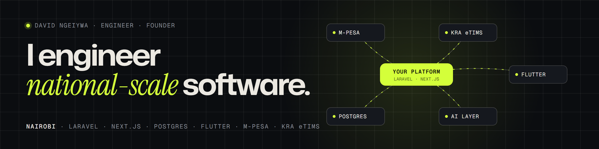

<picture>
  <source media="(prefers-color-scheme: dark)" srcset="assets/header-dark.png">
  <source media="(prefers-color-scheme: light)" srcset="assets/header-light.png">
  
</picture>

I'm a software engineer and founder in Nairobi: founder of **Nolvex**, co-founder of **Novatrix** (trade, logistics and business software for Africa) and **Baobab Labs**, and Head of IT on a consultancy basis at **Digital Tailor Agency** and **Call Experts**.

I build the load-bearing parts: multi-tenant data models, payroll and tax engines, payments that reconcile, and the integrations — M-Pesa, KRA eTIMS, biometrics, LLMs — that make them work in Kenya. 2,900+ commits across 40+ platforms since 2021, almost all in private client repositories, so the case studies live on [my site](https://davidngeiywa.github.io).

### Selected work

| Project | What | Role | Stack |
|---|---|---|---|
| [**Central Bank of Kenya**](https://davidngeiywa.github.io/work/central-bank-of-kenya/) | Website platform: 24 purpose-built plugins, approval workflows, treasury calculators, public data API | Lead developer | WordPress · PHP 8.3 · Nginx |
| [**Communications Authority of Kenya**](https://davidngeiywa.github.io/work/communications-authority-of-kenya/) | Drupal → WordPress rebuild generated from Figma, held to it by 273 automated checks | Lead developer | WordPress · Elementor · Puppeteer |
| [**Thrive HRMS**](https://davidngeiywa.github.io/work/thrive-hrms/) | Multi-tenant HR & payroll SaaS with a Flutter app and face-match attendance kiosks | Technical lead | Laravel · Vue · Flutter · AWS |
| [**Freitex**](https://davidngeiywa.github.io/work/freitex/) | Clearing & forwarding OS: Postgres row-level-security tenancy, import duty as versioned data | Co-founder, architect | Laravel 12 · Postgres · React |
| [**Werezi Books**](https://davidngeiywa.github.io/work/werezi-books/) | Omnichannel commerce: one inventory ledger, POS, M-Pesa and guarded AI search | Lead developer, 4 years | Laravel · M-Pesa · Gemini |
| [**AutoCore ERP**](https://davidngeiywa.github.io/work/autocore-erp/) | Multi-branch auto-care ERP: POS, workshop, procurement, AI briefings | Sole developer | Laravel 11 · three.js |

[All 37 projects →](https://davidngeiywa.github.io/#archive)

### Now

- Taking **Freitex** to its first pilot tenants with Novatrix.
- Two national institution websites heading to launch.
- Writing more of this down — architecture notes and Kenya-specific building blocks.

Laravel · PHP · Next.js · React · TypeScript · Vue · Flutter · PostgreSQL · MySQL · Supabase · WordPress · AWS

[Portfolio](https://davidngeiywa.github.io) · [david@dta.co.ke](mailto:david@dta.co.ke) · Nairobi, UTC+3
